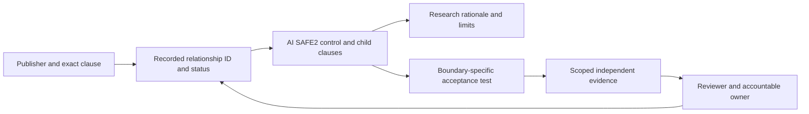
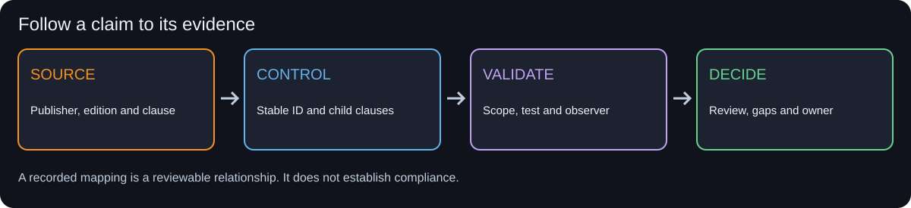

# AI SAFE2 Rosetta Stone

Translate an external requirement into applicable AI SAFE2 controls and child clauses, the implementation boundary, an acceptance test, scoped evidence and a supported repair path. Reverse queries must resolve the same relationship records. Evidence can be reused when role, revision, scope, freshness and obligation permit it.

The recovered baseline contains 496 tag rows and 706 AISM cells. One tag is the internal dependency E5.1_linked. The 33 external source-family records reconcile the original register with the CSA AICM crosswalk family. These historical relationships retain unreviewed status. Exact publisher clauses, editions and legal applicability require direct review. None of the recovered percentages is a verified current coverage denominator.

## Find the validation you care about

| Start with | Route | What to inspect |
| --- | --- | --- |
| Your framework or standard | [Source-family index](ROSETTA-SOURCE-INDEX.md) | Exact edition, external clause, recorded status and missing review fields |
| An AI SAFE2 control | [Control contracts](CONTROLS-V3.5.md) or `safe2 framework query --control CP.12` | Child clauses, research rationale and implementation acceptance |
| A requirement keyword | [Offline mapping explorer](../dashboard/rosetta.html) | Filter source, control, status and text together; expand a relationship's evidence |
| A deployment or product | [Ecosystem adoption](V35-ECOSYSTEM-ADOPTION.md) and [Technology Card](../AISM/templates/TECHNOLOGY-CARD.md) | Actual boundary, scope, observer, results, uncertainty and retained authority |
| Review gaps | `safe2 framework audit --strict` | Failures, unassessed fields, missing distribution evidence and source limits |

GitHub shows the explorer's HTML source. To use its interactive view, serve a reviewed checkout locally:

```bash
python -m http.server 8765 --bind 127.0.0.1
```

Open `http://127.0.0.1:8765/dashboard/rosetta.html`. Filter by a source family, choose a control, then expand **Inspect validation evidence and missing review fields**. The URL fragment preserves the filters. Download matching JSON for review. This page uses embedded canonical records and makes no remote requests. A Pages deployment is separate from this source candidate.

## Follow one relationship end to end



Example: choose `NIST_AI_RMF`, inspect a recovered relationship, resolve its control ID, read its clauses and research, then assess the intended deployment through the Technology Card. If an exact clause, edition or independent result is missing, retain **unassessed**. A new control such as CP.12 can have no recovered source relationship; the explorer exposes that gap instead of inventing a mapping.

## CLI and source records

Use `safe2 framework query --control CP.12`, `safe2 framework query --source NIST_AI_RMF`, and `safe2 framework audit`. The audit provides bounded structural/review-field checks for the sixteen rule classes described in [the expansion review](FRAMEWORK-EVIDENCE-EXPANSION.md). `--strict` holds incomplete review status. Repository CI checks packaged and generated parity. The CLI cannot establish the content of an inaccessible external standard.

The registry preserves source, locator, relationship type, rationale and status. Approved relationships must identify role, scope, exclusions, direct source review, reviewer, source revision, revisit trigger, verified source status and evidence appropriate to the claim. Historical tag or crosswalk chains alone cannot establish approved direct equivalence. Missing or disputed coverage stays visible.

The 64 discovery-source entries preserve the broader research inventory. Admit publisher, edition, status, licensing and unit inventory before promoting one to an operational mapping target. Separate CoSAI, AISVS, COSAiS and SPVS. Source programs evolve independently of AI SAFE2; refresh exact sources and repeat comparative tests before claiming a measured advantage.

[Machine registry](../safe2/data/rosetta-v3.5.json) | [Control contracts](CONTROLS-V3.5.md) | [Shared docs](README.md) | [Framework home](../README.md)




A recorded mapping is a reviewable relationship. It does not establish compliance.

## What the checks establish

| Rule class | Current automated check or route | Review still needed |
| --- | --- | --- |
| RS01-RS02 | Required source fields and a locator admitted to the declared inventory | Publisher authenticity, exact edition and clause meaning |
| RS03-RS04 | Known control IDs, relationship vocabulary and recorded rationale | Clause-level applicability and whether the rationale is correct |
| RS05-RS07 | Role/scope/exclusion fields, direct-review declaration and scoped evidence fields | Authenticity, independence, effectiveness and legal applicability |
| RS08-RS10 | Review states, recovered-record counts and shared forward/reverse records | A valid obligation denominator and actual coverage assessment |
| RS11-RS14 | Review dates, source revision, verification declaration, reuse scope and recorded conflicts | Source-change detection, reviewer authority and substantive conflict resolution |
| RS15 | Repository CI checks current projections and packaged mirrors | Installed/deployed copies require their own revision check |
| RS16 | Required control descriptions; explorer links to clauses, research and acceptance paths | Human usability testing and deployment-specific repair verification |

An approved label with missing applicable review fields fails its checks. A historical/unreviewed record remains visible and unassessed. The default structural audit may finish without errors while review gaps remain; `--strict` returns a hold for incomplete review, including absent distribution evidence. No mode grants compliance or operating authority.
