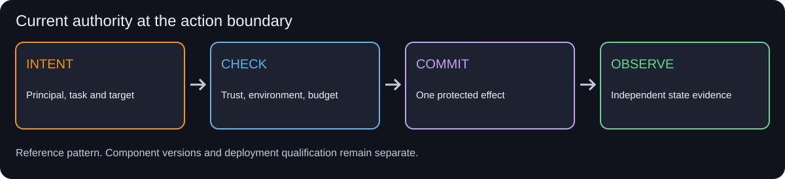

# AI SAFE² Core Gateway v3.0

<!-- ENTRY-ROUTES:START -->
**On this page:** [Adopt](#use-core-gateway-with-v35) · [Evidence](#version-and-conformance-boundary) · [Architecture](#architecture) · [Start](#quick-start) · [Next](#-navigation)
<!-- ENTRY-ROUTES:END -->

<!-- REPOSITORY-ROUTES:START -->
[](../README.md)
[Framework home](../README.md) | [Topic map](../docs/README.md) | [Mapping validation](../docs/ROSETTA-STONE-V35.md) | [Component status](../docs/V35-ECOSYSTEM-ADOPTION.md) | [Agent routes](../llms.txt)
<!-- REPOSITORY-ROUTES:END -->

[](README.md)
### North-south runtime enforcement for the AI SAFE² v3.5 framework

[](../README.md)
[](./main.py)
[](../00-cross-pillar/README.md)

[Framework Home](../README.md) | [Cross-Pillar Governance](../00-cross-pillar/README.md) | [AISM](../AISM/) | [NEXUS](../NEXUS/) | [Dashboard](https://cyberstrategyinstitute.github.io/ai-safe2-framework/dashboard/)

**Previous:** [← Scanner](../scanner/README.md) | **Related:** [NEXUS](../NEXUS/) | [MCP Agent-to-Tool Profile](../00-cross-pillar/cp5_mcp_v35.md)

---

<!-- V35-ADOPTION:START -->


Reference pattern. Component versions and deployment qualification remain separate.

## Use Core Gateway with v3.5

**Source status: compatible-reference.** Provider proxy; existing v3.0 component evidence remains scoped to its observed boundary.

**Next:** Bind the final provider request to current principal, task, policy and environment; reserve aggregate consumption atomically; verify bypass and outage behavior.

[Review the adoption requirements](../docs/V35-ECOSYSTEM-ADOPTION.md) | [Current control contracts](../docs/CONTROLS-V3.5.md) | [Research rationale](../research/README.md) | [Source and published versions](../docs/COMPONENT-VERSIONS.md)
<!-- V35-ADOPTION:END -->

## Gateway evidence and technology contribution

Gateway action-risk routing scores are separate from organizational AISM
maturity and the [Technology Contribution Profile](../AISM/TECHNOLOGY-CONTRIBUTION-PROFILE.md).
Record provider, tool, and agent-to-agent boundaries separately. A mediated
provider request does not establish containment of direct tool or delegated paths.
Use the [validation guide](../AISM/TECHNOLOGY-VALIDATION.md) to test interception,
authorization, actuation, outage, revocation, and legitimate utility before
claiming runtime effectiveness.

## Version and Conformance Boundary

The current gateway implementation is **Gateway v3.0**. AI SAFE² v3.5 did not silently rename this component.

“Core Gateway” is the north-south provider proxy. “NEXUS Sovereign Gateway” is
the separate NEXUS component's gateway scaffold and follows the NEXUS source
version. These names and version numbers identify different components. See
the [component version map](../docs/COMPONENT-VERSIONS.md).

The gateway remains a compatible reference component for the **north-south enforcement plane** with its existing scoped evidence; v3.5 introduces additional requirements that need separate implementation and qualification. Existing v3.0 gateway audit evidence therefore retains its v3.0 component identity until a separately tested gateway release changes that identity.

This distinction is intentional:

- **AI SAFE² v3.5** is the current framework.
- **Gateway v3.0** is the current gateway component.
- **NEXUS v0.6** is the current NEXUS component (v0.6.0).
- Component versions should not be rewritten merely for visual consistency.

---

## Architecture

```text
Client / Agent
      |
      v
HeartbeatMonitor       hard stop on invalid liveness state
      |
RateLimiter            per-identity request limits
      |
ProviderAdapter        normalized provider boundary
      |
RiskScorer             action x sensitivity x history
      |
HITLCircuitBreaker     AUTO / MEDIUM / HIGH / CRITICAL
      |
ImmutableAuditLog      HMAC-SHA256 chained evidence
      |
Provider Dispatch      Anthropic / OpenAI / Gemini / Ollama / OpenRouter
      |
ResponseScanner        outbound exfiltration and injection checks
      |
      v
Client Response
```

### Enforcement Components

| Component | Function |
|---|---|
| `HeartbeatMonitor` | Validates liveness state and activates safe mode on invalid conditions |
| `RateLimiter` | Bounds request volume per identity |
| `ProviderAdapter` | Normalizes provider requests while preserving the original upstream payload |
| `RiskScorer` | Computes the gateway risk vector used for HITL routing |
| `HITLCircuitBreaker` | Applies tiered human authorization requirements |
| `ImmutableAuditLog` | Produces HMAC-chained audit evidence and detects tampering |
| `ResponseScanner` | Inspects upstream output before return to the caller |
| `SafeMode` | Blocks normal traffic until operator-controlled recovery |

---

## Enforcement-plane model

| Plane | Primary component/path | Gateway role |
|---|---|---|
| **North-south** | Gateway | Primary reference enforcement component |
| **East-west** | NEXUS | Gateway may carry/record NEXUS context but is not the primary A2A governance layer |
| **Agent-to-tool** | CP.5.MCP + NEXUS MCP adapter/toolkit | Gateway is not a substitute for MCP-specific authorization/profile enforcement |

The gateway therefore should not be used as evidence that MCP-14 through MCP-19 are implemented. Those controls must be evaluated on the actual agent-to-tool path.

---

## Quick Start

### Dependencies

```bash
python3 -m pip install fastapi uvicorn httpx pyyaml requests
```

### Required secrets

```bash
export AUDIT_CHAIN_KEY="$(openssl rand -hex 32)"
export OPERATOR_DEACTIVATION_KEY="$(openssl rand -hex 16)"
```

Set the credential for the selected provider, for example:

```bash
export ANTHROPIC_API_KEY="..."
# export OPENAI_API_KEY="..."
# export GEMINI_API_KEY="..."
# export OPENROUTER_API_KEY="..."
```

### Run

```bash
uvicorn gateway.main:app --host 127.0.0.1 --port 8080
```

---

## Provider Support

| Provider | Credential/config |
|---|---|
| Anthropic | `ANTHROPIC_API_KEY` |
| OpenAI | `OPENAI_API_KEY` |
| Gemini | `GEMINI_API_KEY` |
| Ollama | local endpoint, normally no API key |
| OpenRouter | `OPENROUTER_API_KEY` |

All providers pass through the same gateway policy stages; provider adapters handle upstream-specific transport details.

---

## NEXUS Relationship

The gateway contains compatibility hooks for NEXUS context and can record NEXUS-related identity/delegation evidence when present.

That does not make the gateway the NEXUS implementation. NEXUS remains the CSI reference path for east-west governance and the v3.1 agent-to-tool adapter contract.

See [NEXUS](../NEXUS/) for the current implementation boundary.

---

## Audit Provenance

Gateway audit records intentionally identify the **gateway component version** that created them. Existing Gateway v3.0 evidence should remain v3.0 evidence.

The audit-chain genesis anchor must not be changed merely because the framework version advances. Doing so would break verification of prior chained records.

A future Gateway v3.1 release should define and test an explicit evidence migration/versioning policy rather than silently rewriting the v3.0 anchor.

---

## Safe Mode

Safe mode blocks governed traffic until explicitly deactivated by the authorized operator path.

Typical triggers include:

- missing, invalid, or stale heartbeat state;
- audit-chain verification failure;
- explicit operator activation.

The safety path remains outside ordinary model authority.

---

## Framework References

- [AI SAFE² v3.5 Framework](../README.md)
- [Cross-Pillar Governance](../00-cross-pillar/README.md)
- [AISM](../AISM/)
- [NEXUS](../NEXUS/)
- [Scanner](../scanner/README.md)
- [MCP v3.1 Profile](../00-cross-pillar/cp5_mcp_v35.md)

---

## 🔗 Navigation

[Framework Home](../README.md) | [Cross-Pillar Governance](../00-cross-pillar/README.md) | [AISM](../AISM/) | [NEXUS](../NEXUS/) | [Scanner](../scanner/README.md) | [Dashboard](https://cyberstrategyinstitute.github.io/ai-safe2-framework/dashboard/)

---

*AI SAFE² v3.5 framework · Gateway v3.0 component · [Cyber Strategy Institute](https://cyberstrategyinstitute.com/ai-safe2/)*
